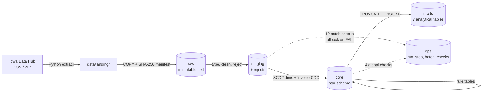

# Iowa Liquor Sales ETL

[](https://github.com/prachi735/iowa-liquor-etl/actions/workflows/ci.yml)

A monthly SQL-first ELT pipeline in **Python** and **PostgreSQL 16** built for the State of Iowa's public liquor sales dataset (~35M historical order lines since Jan 2012; profiled on 225,299 lines from the monthly window and tested end-to-end against PostgreSQL 16).

**Data:** every spirits order placed by Iowa grocery, liquor, and convenience stores since January 2012, published monthly by the State of Iowa (credit at the end).

## What it demonstrates

- **Idempotent incremental loads.** Every file is fingerprinted by SHA-256 and every invoice by a normalized hash of its lines. Overlapping monthly drops safely insert new invoices, replace changed ones, soft-delete missing ones, and ignore unchanged data.
- **SCD Type 2 history with retroactive key repointing.** Stores, items, and vendors maintain dated versions (`valid_from` / `valid_to`), so historical sales stay tied to the store name and item attributes valid on their order date—even when late-arriving changes require repointing older fact rows.
- **Transactional data-quality gates.** 16 SQL checks (12 batch, 4 global) reconcile row counts, dollars, arithmetic, and SCD continuity. Any blocking error rolls back the entire batch atomically while still persisting check results and failure metadata in `ops`.
- **Data-driven business rules.** Store chains/types and category groups live in editable SQL rule tables (`core.store_type_rule`, `core.category_group_rule`) preserved across `setup` re-runs and re-applied with `python -m pipeline rules`.
- **Full observability.** Every CLI invocation, step timing, loaded batch, and check result is logged to both stdout (Python `logging`) and the `ops` schema.

## Architecture



| Layer | Purpose |
| --- | --- |
| `raw` | Every row exactly as delivered, all text, tagged with `batch_id`. Never edited. |
| `staging` | Current batch: trimmed, typed (`pg_input_is_valid`), keys normalized, `unit_price` derived. Unusable rows go to `staging.rejects` with a reason. |
| `core` | `dim_store`, `dim_item`, `dim_vendor` (SCD Type 2), `dim_category` (Type 1), `invoice` (audit/CDC header), `fact_sales`, and editable rule tables. |
| `marts` | 7 pre-defined tables with primary keys, refreshed via `TRUNCATE` + `INSERT` inside a transaction so downstream BI views and grants never break. |
| `ops` | `run`, `run_step`, `batch` (file manifest), and `check_result`. |

Data anomalies discovered during profiling—and how the pipeline handles each—are documented in [docs/business_rules.md](docs/business_rules.md). Full table and column specs are in [docs/data_dictionary.md](docs/data_dictionary.md).

## Analytical Questions & Marts

The `marts` schema is designed around six recurring commercial questions:

| # | Business Question | Mart Table | Grain |
| --- | --- | --- | --- |
| **KPI** | What are overall monthly revenue, volume, returns, and active store counts? | `marts.monthly_kpis` | `month` |
| **Q1** | Which spirit categories are gaining share of dollars and litres? | `marts.category_month` | `month × category_group` |
| **Q2** | Is spend shifting toward higher price tiers (per 750 ml equivalent)? | `marts.price_tier_month` | `month × category_group × price_tier` |
| **Q3** | Are top product lines growing via wider distribution (more stores) or velocity (litres/store)? | `marts.product_line_month` | `month × product_line × category_group` |
| **Q4** | Are small bottle formats (50 ml–375 ml) growing, and in which store types? | `marts.size_store_type_month` | `month × size_band × store_type` |
| **Q5** | What share of newly launched SKUs are still ordered 12 months after launch? | `marts.item_lifecycle` | `item_no` |
| **Q6** | How concentrated is spend across stores, and are chains gaining on independents? | `marts.store_year` | `year × store_no` |

## Quickstart

Needs **Python 3.10+** and **PostgreSQL 16+** (staging uses `pg_input_is_valid`).

### Option 1: Docker Compose (fastest, macOS / Linux / Windows)

```bash
docker compose up -d --wait
python3 -m venv .venv && source .venv/bin/activate
pip install -r requirements.txt
cp .env.example .env                # set PGPASSWORD=postgres (matches docker-compose.yml)

# Run setup, load the real 312-line fixture, transform, and inspect status
make demo
make test
```

### Option 2: Existing local PostgreSQL 16

**macOS / Linux**

```bash
python3 -m venv .venv && source .venv/bin/activate
pip install -r requirements.txt
cp .env.example .env                # set PGPASSWORD
python -m pipeline setup
```

**Windows (PowerShell)**

```powershell
py -m venv .venv
.venv\Scripts\Activate.ps1          # if blocked: Set-ExecutionPolicy -Scope CurrentUser RemoteSigned
pip install -r requirements.txt
Copy-Item .env.example .env         # then open .env and set PGPASSWORD
python -m pipeline setup            # creates the database and all objects
```

Or put a downloaded zip/csv in `data\` and run the guided script (`first_run.log`):

```powershell
powershell -ExecutionPolicy Bypass -File scripts\first_run.ps1
```

### Loading real Iowa Data Hub files

```bash
# Load a file downloaded from data.iowa.gov (zip or csv)
python -m pipeline load path/to/iowa_liquor_sales_past_30_days_1075_rows.zip
python -m pipeline transform
python -m pipeline status

# Full multi-year backfill (oldest year first), then monthly incremental run
python -m pipeline reset --yes      # start clean if you loaded test files before
python -m pipeline backfill --from 2019 --to 2025
python -m pipeline run --dataset 2026
python -m pipeline run              # monthly refresh (past 30 days)
```

Load years oldest first so SCD Type 2 effective dates advance chronologically. `download`, `backfill`, and `run` fetch from `https://idh-be.iowa.gov/api/v1/datasets/<id>/rows.csv`; if the portal splits a download into multiple parts, pass the downloaded archive directly to `load` or `run --file`.

### CLI Commands

| Command | Does |
| --- | --- |
| `setup` | Create the database and every schema, table, function, and default rule (safe to re-run; preserves rule edits) |
| `load FILE...` | Load CSV or zip files into `raw`; files already loaded (same SHA-256) are skipped |
| `transform` | Stage and merge waiting batches, run batch + global checks, refresh marts |
| `run [--dataset D] [--file F]` | Monthly update: download (or use a local file), load, transform, prune old raw copies |
| `backfill --from Y [--to Y]` | Download, load, and transform whole years oldest first |
| `download D` | Download a dataset only: a year (`2012`–`2026`), `past30`, `past90`, or `combined` |
| `check`, `marts` | Run global checks, or refresh marts, on their own |
| `rules` | Re-apply edited rule tables to dimensions, then refresh marts |
| `status` | Show recent runs, batches, non-zero check results, and core row counts |
| `retry BATCH` | Reset a failed batch to `loaded` so `transform` can re-attempt it |
| `prune-raw [--keep N]` | Delete raw rows of older transformed batches |
| `reset --yes` | Drop all pipeline schemas and run `setup` again |

## Sample Output

Running `make demo` against the included 312-line real-data sample (`tests/fixtures/sample_orders.csv`):

```text
15:33:34 INFO    -> transform (batch 1) ...
15:33:34 INFO       11_stage_lines.sql              0.1s
15:33:34 INFO       21_dim_category.sql             0.0s
15:33:34 INFO       22_dim_vendor.sql               0.0s
15:33:34 INFO       23_dim_store.sql                0.0s
15:33:34 INFO       24_dim_item.sql                 0.0s
15:33:34 INFO       30_fact_sales.sql               0.1s
15:33:34 INFO       40_repoint_fact_keys.sql        0.0s
15:33:34 INFO       26_apply_rules.sql              0.0s
15:33:34 INFO       done in 0.3s, 312 rows - invoices new 44, changed 0, deleted 0, unchanged 0
15:33:34 INFO       [ ok ] raw rows = staged + rejected: raw 312, staged 312, rejected 0
15:33:34 INFO       [ ok ] rejected rows: 0 of 312 rows rejected
15:33:34 INFO       [ ok ] fact matches file, invoice by invoice: 44 invoices, 312 lines, $53,562.93 in the file
15:33:34 INFO       [ ok ] invoices deleted by this file: 0 of 44 invoices in the date window
15:33:34 INFO       [ ok ] invoices with one store and one date: 0 invoices span more than one store or date
15:33:34 INFO       [note] dollars = bottles x list price: 1 of 312 priced lines differ by more than 1% (unit price uses dollars / bottles)
15:33:34 INFO       [ ok ] litres = bottles x bottle size: 0 lines off by more than 0.01 L
15:33:34 INFO       [ ok ] category codes mapped to a group: all codes mapped
15:33:34 WARNING    [warn] weekdays with orders: no orders on Mon 05 Oct 2026, Tue 06 Oct 2026, Mon 12 Oct 2026, Tue 13 Oct 2026, Thu 29 Oct 2026
15:33:34 INFO       [ ok ] look-alike lines on different invoices: 0 groups of identical lines across invoices
15:33:34 INFO       [note] store details present: 32 lines from 1 stores without city or county
15:33:34 INFO       [ ok ] invoice ids not reused across dates: no id clashes with older invoices
15:33:34 INFO    -> global checks ...
15:33:34 INFO       [ ok ] fact lines linked to store and item: 0 lines without a store or item version
15:33:34 INFO       [ ok ] history tables consistent: one current version per key, no gaps
15:33:34 INFO       [ ok ] invoice totals = fact totals: 0 invoices disagree
15:33:34 INFO       [ ok ] no missing months: every month has normal volume
15:33:34 INFO       done in 0.0s
15:33:34 INFO    -> build marts ...
15:33:34 INFO       done in 0.2s, 7 rows - tables rebuilt
15:33:34 INFO    Run 2 succeeded.
```

### Example Mart & SCD Type 2 Results (from the fixture)

**SCD Type 2 store rename captured in `core.dim_store`** (store `4042` renamed mid-month on 9 Oct 2026):

| `store_sk` | `store_no` | `store_name` | `store_city` | `valid_from` | `valid_to` | `is_current` |
| --- | --- | --- | --- | --- | --- | --- |
| 19 | `4042` | `LAKE OHANA MARKET / MINEOLA` | `GLENWOOD` | `1900-01-01` | `2026-10-08` | `false` |
| 20 | `4042` | `LAKE OHANA MARKET / GLENWOOD` | `GLENWOOD` | `2026-10-09` | `9999-12-31` | `true` |

**Top categories in `marts.category_month` (Oct 2026 sample):**

| `category_group` | `dollars` | `liters` | `bottles` | `dollar_share` |
| --- | ---: | ---: | ---: | ---: |
| Vodka | $19,316.84 | 1,263.575 | 1,368 | 36.32% |
| Liqueurs and schnapps | $12,708.55 | 414.000 | 1,362 | 23.89% |
| American whiskey | $6,207.19 | 204.425 | 404 | 11.67% |
| Canadian whisky | $4,098.88 | 141.625 | 185 | 7.71% |
| Tequila and mezcal | $2,925.24 | 65.150 | 152 | 5.50% |

**Spend by 750 ml equivalent tier in `marts.price_tier_month` (Oct 2026 sample):**

| `price_tier` | `dollars` | `bottles` |
| --- | ---: | ---: |
| 1 Value (under $12) | $7,420.66 | 1,620 |
| 2 Premium ($12-17) | $18,350.35 | 1,006 |
| 3 High-end ($17-30) | $15,887.33 | 774 |
| 4 Super-premium ($30+) | $11,527.39 | 635 |

## Data Quality Checks

| Scope | Check | Stops the load when |
| --- | --- | --- |
| Batch | Raw rows = staged + rejected | Any row is unaccounted for |
| Batch | Rejected rows | More than 0.1% of the file (and more than 10 rows) |
| Batch | Fact matches file, invoice by invoice | Any invoice's lines or dollars differ |
| Batch | Invoices deleted by this file | More than 2% of invoices in the file's dates (and more than 10) |
| Batch | One store and date per invoice | Warning only |
| Batch | Dollars = bottles × list price | Note; warning above 5% of lines |
| Batch | Litres = bottles × bottle size | Warning only |
| Batch | Category codes mapped to a group | Warning only |
| Batch | Every weekday has orders | Warning only (holidays or gaps) |
| Batch | Look-alike lines on different invoices | Note only: counted, never deleted |
| Batch | Store details present | Note only |
| Batch | Invoice IDs not reused across dates | An ID already stored arrives with a date >60 days away |
| Global | Fact lines linked to store and item | Any line without a version |
| Global | History tables consistent | Overlaps, gaps, or not exactly one current version |
| Global | Invoice totals = fact totals | Any invoice disagrees |
| Global | No missing months | Warning: a month under half of the prior three |

## Architecture & Scaling Trade-offs

- **Why plain Python + SQL instead of Airflow/dbt?** For a single-source monthly batch pipeline into PostgreSQL, `psycopg` + numbered SQL files keeps deployment trivial (two pip packages, zero orchestration overhead) while preserving the same layered modeling, testing, and idempotency guarantees.
- **Why `TRUNCATE` + `INSERT` for marts?** Defining mart tables with explicit primary keys in `sql/00_setup/07_marts.sql` and refreshing via `TRUNCATE` + `INSERT` inside a transaction keeps refresh logic simple without dropping dependent BI views or table permissions.
- **Scaling to the full 35M-row history:** For multi-year production SLAs on tens of millions of rows, the next natural steps are range-partitioning `core.fact_sales` by `ordered_on` (year/month) and switching monthly marts + global checks to refresh only partitions touched by the incoming batch.

## Tests & CI

```bash
python -m pytest -v
ruff check pipeline tests
```

Unit tests require no database. Integration tests run against PostgreSQL 16 in an isolated `iowa_liquor_test` database and are executed automatically in GitHub Actions (`.github/workflows/ci.yml`). They verify:
- Header validation, schema drift rejection, and reordered-column tolerance
- Initial load, SHA-256 duplicate skip, and invoice-level new/changed/deleted/unchanged merges
- SCD Type 2 versioning on mid-month store renames + retroactive fact key repointing
- Automatic rollback on truncated downloads (>2% missing invoices) and reused invoice IDs
- Preservation of custom rule edits on `setup` re-runs and preservation of BI views across `marts` rebuilds

## Project Layout

```text
pipeline/            Python CLI, extract, COPY loader, transform runner, check runner, ops log
sql/00_setup/        schemas, ops/raw/staging/core/marts DDL, cleaning functions, default rules
sql/10_staging/      type, clean, hash, and validate one batch
sql/20_core/         SCD Type 2 dimensions, invoice-level fact merge, surrogate key repointing
sql/25_rules/        apply category group and store type rule tables
sql/30_marts/        7 analytical marts refreshed via TRUNCATE + INSERT
sql/90_checks/       batch/ and global/ checks (one SELECT per file)
tests/               pytest unit + integration suite and 312-line real-data fixture
scripts/             first_run.ps1: one-command first run on Windows
docs/                business_rules.md and data_dictionary.md
docker-compose.yml   one-command PostgreSQL 16 local instance
.github/workflows/   GitHub Actions CI (ruff + pytest on PostgreSQL 16)
```

## License & Data Credit

- **Code:** Licensed under the [MIT License](LICENSE).
- **Data:** Iowa Department of Revenue, Alcohol Operations Bureau. *Iowa Liquor Sales, January 2012 - Current* [Dataset]. Iowa Data Hub, https://data.iowa.gov/catalog/dataset/1051. Licensed under [CC BY 4.0](https://creativecommons.org/licenses/by/4.0/). Data cleaned, transformed, and analysed by Prachi Singh; not endorsed by the State of Iowa.
